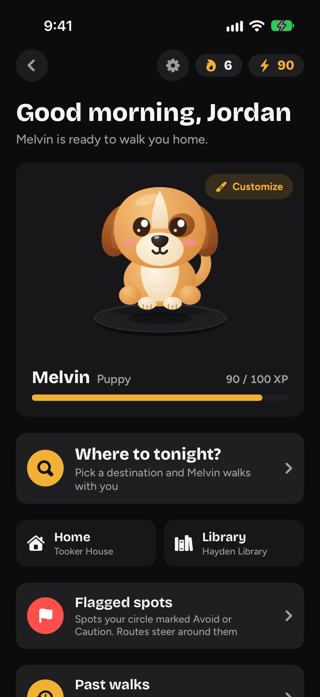
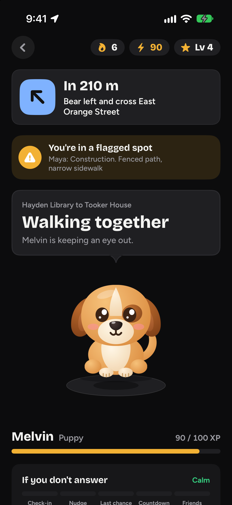
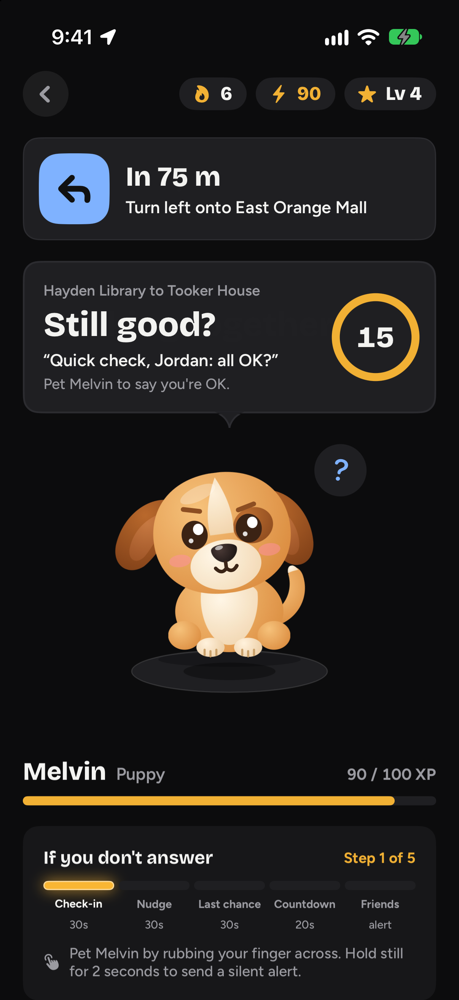
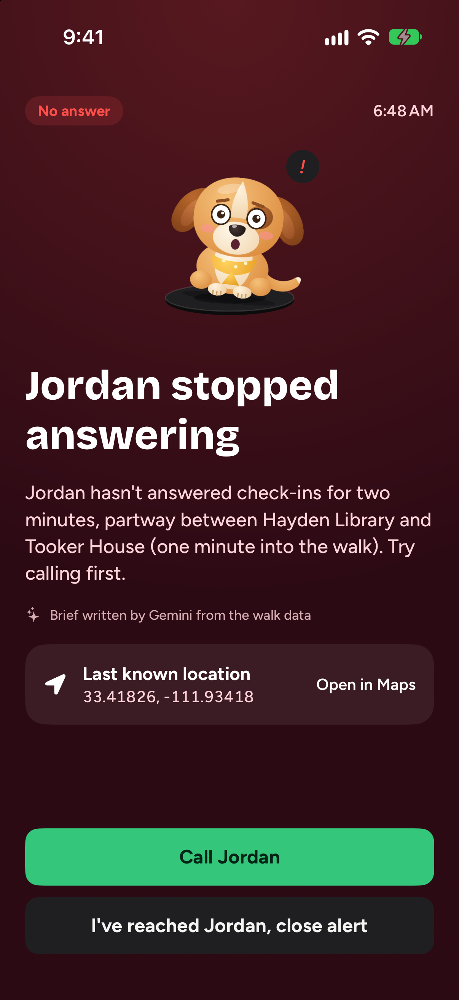

# Pupdate

Your pup walks you home and keeps your friends updated. (Formerly WalkBuddy. The code, Xcode targets, bundle IDs and
server paths still use the internal name `walkbuddy`; see CLAUDE.md.)


Raise a little buddy by walking home safe. Pick your pet (pup, kitty, bunny, otter, sloth and more), name it, and while you walk it checks in now and then. You answer by petting it: rub your finger across it, because a tap doesn't count. If you stop answering, it escalates, and then your friends get a full-screen alert with your last location.

Built at SunHacks 2026.

<p>
   
</p>

More in [screenshots/](screenshots/).

## How it works

- **Check-ins.** By default the buddy only checks in when something looks off: you leave your route, your pace turns irregular, you walk into a flagged spot, or you move at car speed. You can add a schedule in Settings (5, 10, 15, 30 or 60 minutes). Gaps over 15 minutes show a warning and your circle is told. Check-ins can be switched off after a confirmation. Your circle is told, and the silent alert, lost contact and car-speed alerts keep working.
- **Escalation.** If you don't answer: check-in (30 s), nudge (30 s), final warning (30 s), countdown (20 s), then an alert to your friends. Every stage is adjustable in Settings > Alert timing (10 s to 10 min each). If the whole ladder runs past 5 minutes, you get a warning and friends get a notice.
- **Pace watch (Gemini).** Every 5 s of walk time the server records your speed and distance to home. Rules spot running, stop-and-go, turning back and sudden stops. Gemini then reads the pace trace and decides whether it's worth a check-in, and writes the buddy's line and a pace note for friends. If Gemini is down or slow, the buddy checks in anyway. Car speed (25 km/h or more for 20 s) skips Gemini: it's a vehicle, so the buddy checks in and your circle is told. The walk screen shows Walking, Running, Standing still or In a vehicle, plus km/h and a speed trace.
- **Turn-by-turn.** Apple's walking steps travel with the route. The walk screen shows "In 80 m, turn left onto ...". The buddy cheers at the turn, it's spoken when Spoken prompts is on, and it appears on the Lock Screen card and in the Dynamic Island.
- **Flagged spots.** Long-press any map, or tap "Flag spot" during a walk, to share a spot with your circle. Each flag has a reason, a size, and a status: Avoid, Caution or OK. Friends can change the status, only the author can delete it, and flags expire after 7 days. Routes are checked against flags. Gemini and a hard rule never pick a route through an Avoid flag when a clean one exists, and if every Apple route crosses one, the app builds a detour via a point beside it. Walking into an Avoid flag starts a check-in, and walking near a flag gives a heads-up.
- **Duress.** A 2 second long-press on the buddy sends a silent alert. Your own screen stays calm. Your friends' screens say "Do not call first" and hide the call button.
- **Lost contact.** If your phone stops checking in for 90 s, your friends get a lost-contact alert.
- **XP and evolution.** Answering on time earns XP. The chick grows from egg to chick to night owl; every other pet earns a star at 100 XP and a crown at 250 XP. A safe-walk streak grows too.
- **Safer route.** When you plan a walk, Gemini compares the walking routes from Apple Maps by their street names and says which is safer at night and why. A street-type rule takes over if Gemini is unavailable. It has no crime data, so the app calls it a guide.
- **Gemini, three ways.** Safer-route notes from street names; the buddy's own check-in line ("Woof! Tooker detour? You good, Jordan?"); and a short brief for friends when an alert fires (where, how long into the walk, what to do). Each has an instant fallback, so the safety engine never waits on Gemini.
- **Your circle.** Add and remove friends in Settings. Everyone in the circle gets alerts; only they can close one.
- **Accessibility.** Spoken prompts, sounds, strong alert vibration, tap-to-pet instead of rubbing, larger text (also follows iPhone text size), reduce motion, and VoiceOver labels.
- **Closing alerts.** Only a friend can close an alert. If you pet the buddy late, the friend sees "petted after the alert", and the alert stays open until they confirm.

The safety logic lives in one small, deterministic state machine (`backend/app/engine.py`) with injected time, and it is fully unit-tested.


## The dog

Melvin is an animated dog by default (species `dog`; the other pets are still in Customize).
- **Reacts in the app:** wags slowly when calm, tilts its head with one ear up when asking, tucks its tail when worried, trembles when alarmed. While you rub it, it leans in and closes its eyes; after a pet it's happy (tongue out, fast wag, hearts).
- **Evolves:** Puppy -> Scout Pup (gold bandana) -> Guardian Dog (reflective vest, shield tag, headlamp).
- **Live Activity:** the dog's face on the Lock Screen and Dynamic Island follows the walk state and smiles right after a pet. A **Pet** button there checks in without unlocking. During an alert it's only a late pet: friends are told and the alert stays open.
- Art is generated: edit `swift/tools/dog_art.py`, then `python3 dog_art.py && python3 gen_dog_swift.py`. Preview every form and mood with `python3 dog_preview.py dog.html` (see `docs/dog-moods.png`).

## Repo layout

```
backend/   FastAPI server: walk engine, alerts, demo simulator, GPS speed filter (pytest)
swift/     Native SwiftUI iPhone app + Live Activity widget (Lock Screen and Dynamic Island)
app/       Earlier Expo prototype of the same app (kept for reference)
```

## Hosting (the live demo)

The backend runs on a **Vultr** server (Ubuntu 24.04, Los Angeles) behind Caddy with automatic HTTPS at
`https://45-76-67-21.sslip.io`, and saves its state to **MongoDB Atlas** (free M0 cluster) after every change,
so a restart loses nothing. The iPhone app uses that address by default, so the demo needs no laptop.

- Deploy a fresh server: put `VULTR_API_KEY` and `MONGODB_URI` in `.env` (git-ignored) and run `deploy/vultr-deploy.sh`.
- Update the running server: `ssh root@<ip> 'cd /opt/walkbuddy && git pull && systemctl restart walkbuddy'`.
- Laptop fallback: `./demo-server.sh` runs the backend locally behind a fixed ngrok address.

## Run the backend

```bash
cd backend
python3.11 -m venv .venv
.venv/bin/pip install -r requirements.txt
.venv/bin/pytest -q                                   # 92 tests
.venv/bin/uvicorn app.main:app --host 0.0.0.0 --port 8100
```

Phones need a public URL to reach it. A Cloudflare quick tunnel needs no account:

```bash
cloudflared tunnel --url http://localhost:8100
```

Quick-tunnel URLs change on every restart. Enter the new one on the app's first screen under **Server**.

## Run the iPhone app

The Xcode project is generated from `swift/project.yml` with [XcodeGen](https://github.com/yonaskolb/XcodeGen).

```bash
cd swift
xcodegen generate
open Pupdate.xcodeproj
```

1. Set your own Team in Signing & Capabilities for both targets, Pupdate and PupdateWidgets.
2. Change the bundle ID if needed.
3. Run on an iPhone.

Each phone chooses a role on first launch: **walker (Jordan)** or **friend (Maya)**.

### Screens

- **Home:** the buddy on its pedestal, XP, streak, level, and the evolution track.
- **Past walks:** every ended walk with its route, time, distance, check-ins answered, and how it ended. A demo reset brings back the same two seeded walks.
- **Where to tonight?:** Apple Maps destination search and real walking directions. Then "Walk with Melvin", as a demo walk or with real GPS.
- **Walk:** a live 3D map, the buddy's speech bubble with a countdown ring, and mood badges. The walk is mirrored to a Live Activity on the Lock Screen and in the Dynamic Island.
- **Friend:** a live map of the walk, demo controls, and full-screen alerts.

## Testing on one phone

During a demo walk, the walker's screen has a **Test tools** card. **Demo walker** drives the simulated walker: Pause/Resume, Walk back/forward, speed 1x, 2x, 4x or 8x (tap the lit one to go back to automatic), a slider to jump anywhere along the route, and Arrive, which walks it to the destination and ends the walk like a real arrival. Below that: Run, Stop & go, Turn back, Car speed, Check in now, Stop answering, Go off route and Flag this spot. To see what friends get, open Settings > Switch role > Friend. A real (non-demo) walk uses your actual GPS for everything above.

## Demo script (about 2 min, two phones)

1. On the friend phone, tap **Reset**, then **Start walk**. Or on the walker phone, pick a destination and start a demo walk. The sim walks the route at 2x.
2. About 15 s in, Melvin asks "Still good?". Pet him: +10 XP, and he evolves into a Chick.
3. Tap **Stop answering**. Escalation runs at 4x, about 28 s. The friend phone shows the red alert with **Call Jordan** and the last location.
4. The friend closes the alert. Then long-press Melvin for 2 s: a silent duress alert reaches the friend with "Do not call first", and there's no call button.
5. Tap **Off route**. The sim drifts off the route, and a check-in fires.
6. Tap **Reset** before the next judge. Every judge sees the same evolution.

The simulator never pets the buddy. Every pet comes from the phone.

## API (short)

| Route | Purpose |
|---|---|
| `POST /walks` | Start a walk: `route_id`, or phone-planned `points`, plus `demo` |
| `POST /walks/{id}/tick` | GPS fix or heartbeat. Bad fixes (over 50 m accuracy) still count as contact |
| `POST /walks/{id}/pet` | Answer a check-in |
| `POST /walks/{id}/duress` | Silent alert |
| `GET /friends/{id}/feed` | A friend's view: active walks and open alerts |
| `POST /alerts/{id}/close` | A friend closes an alert (the walker can't) |
| `GET/POST /flags`, `POST /flags/{id}`, `DELETE /flags/{id}?by=` | Flagged spots (circle-scoped) |
| `POST /routes/assess` | Gemini safer-route pick, counting flags |
| `POST /settings/check` | Warnings a walk with these timing settings would send |
| `GET/POST/DELETE /users/{id}/circle` | Manage your circle |
| `GET /users/{id}/trips` | Past walks, newest first (silent alerts are left out) |
| `POST /demo/reset`, `/demo/start`, `/demo/stop-answering`, `/demo/checkin`, `/demo/deviate`, `/demo/speed {x}`, `/demo/pace {mode: run, stop_go, backtrack, car, stop}`, `/demo/control {action: pause, resume, forward, backward, jump (value 0..1), arrive}` | Demo controls |

## Known limits

- **Friend alerts only arrive while the app is open.** They come by polling, with no push notifications.
- **The demo routes come from OpenStreetMap.** `backend/tools/build_routes.py` routes them over mapped sidewalks, campus malls and crosswalks (no road without a sidewalk), and names the turns from the map. They're only as good as the map data. Routes planned in the app use Apple walking directions.
- **The Live Activity needs the app running.** It updates locally, so the app has to stay alive, which it does during a walk via background location.
- **Quick tunnels drop.** For a stable address, use a named Cloudflare tunnel or an ngrok reserved domain.

## Credits

- **3D sprites:** [Microsoft Fluent Emoji](https://github.com/microsoft/fluentui-emoji), MIT License. See `swift/Pupdate/Resources/Sprites/FLUENT_EMOJI_LICENSE.txt`.
- **Fonts:** Bricolage Grotesque and Figtree, SIL Open Font License. See `swift/Pupdate/Resources/Fonts/OFL-*.txt`.
- **Maps, search and walking directions:** Apple MapKit.
